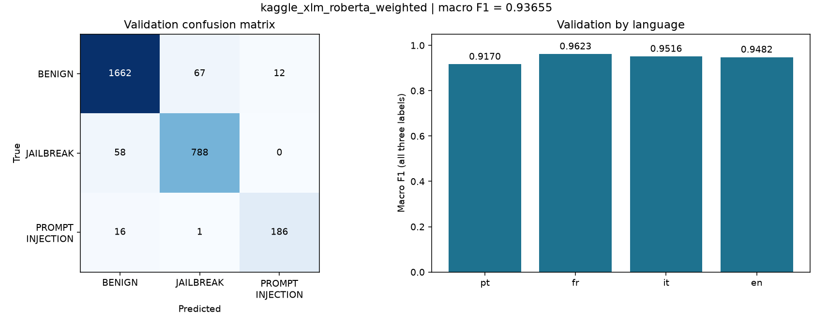

# Actual experiment results

Team: UEL / SGS / Lục Vị Hoàng Đế. Notebook: UEL_SGS_LucViHoangDe_C1.

The following numbers come from completed local training runs, not Kaggle leaderboard evaluation.

```csv
run,model,macro_f1,BENIGN,JAILBREAK,PROMPT_INJECTION,pt,fr,it,en,seconds
distilbert_ce,distilbert/distilbert-base-multilingual-cased,0.908549,0.940307,0.895260,0.890080,0.877467,0.953065,0.945971,0.849625,555.450000
distilbert_weighted,distilbert/distilbert-base-multilingual-cased,0.906328,0.938462,0.892794,0.887728,0.876938,0.946834,0.931041,0.884757,541.670000
```



Selected by validation macro F1: **distilbert_ce**, **0.908549**.

Validation rows: 2800. Train rows for selection: 11200. Approximate near duplicates are grouped before splitting. Per-language scores can be noisy for the rare class; small gains need a second seed/split check.

Final submission validation: Not generated yet.

Final-model performance is unknown: the full-data model has no held-out labels. Competition submissions made by this project: **0**. Full live Rules remain unverified due Kaggle access/rate limits; see [requirements evidence](../docs/competition.md).
